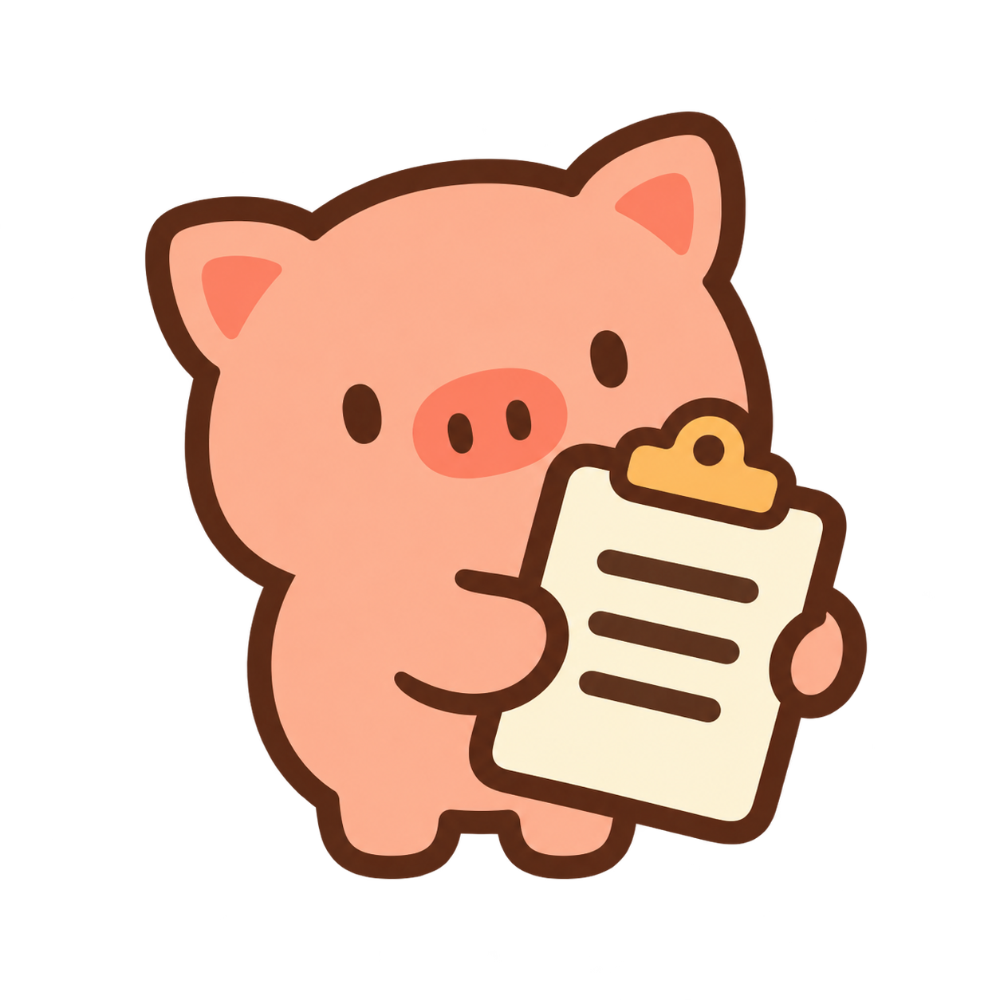

<p align="center">
  
</p>

<h1 align="center">Copiggy</h1>

<p align="center">A little home for what you copy.</p>

<p align="center">
  <strong>v0.1.0</strong> · macOS · Native UI
</p>

<p align="center">
  <a href="#features">Features</a> ·
  <a href="#getting-started">Get started</a> ·
  <a href="#usage">Usage</a> ·
  <a href="docs/usage.md">Guide</a>
</p>

Copiggy is a native clipboard companion for macOS. Browse what you copied, keep useful clips, and prepare content before pasting. A compact card panel stays one shortcut away; Paste Guard helps you avoid pasting into the wrong app.

<!-- Add the product demo and screenshots here when available. -->

## Features

- **History at a glance.** Distinct cards for 14 content types, from text and images to maps, colors, dates and credentials. Source app icons, search and keyboard navigation stay consistent. Repeated copies with the same protection scope move to the front.
- **Copy with care.** Press **⌃⌘C** to bind a copy to its source app. While Paste Guard is on, standard keyboard paste is blocked in other apps.
- **Preview and refine.** Read text, zoom images, browse pages, inspect colors and timestamps, or open an address in Mail, Maps or Finder. Preview JSON formatting before accepting it. The original clip stays intact.
- **Keep the useful bits.** Pin clips for easy access, delete what you no longer need, and choose how long to keep ordinary history.
- **Made for your Mac.** System glass, native popovers, light and dark themes, and a little pig in the menu bar. English, 简体中文, 繁體中文 and 日本語 are built in.

## Getting started

Build from this source folder on an Apple Silicon Mac with Go and full Xcode 26 or later installed:

```sh
./scripts/package.sh
open build/Copiggy.app
```

The scripts select Go 1.27.1 and may download the toolchain and dependencies on the first run. Node, Bun and cgo are not required. You can move `build/Copiggy.app` into Applications; the packaged app runs without Go installed.

The current build targets **macOS 13 or later on Apple Silicon**. Manual verification has been on macOS 26.5; earlier supported releases still need verification. Liquid Glass is used where available, with a system blur fallback on older versions.

Packages are locally signed and not notarized. A copy downloaded from someone else may need approval in **System Settings → Privacy & Security** on first launch.

## Usage

1. Copy with **⌘C** as usual.
2. Click the menu-bar pig or press **⌃⌥⇧Space** to open Copiggy.
3. Browse with **← / →**, search with **⌘F**, or press **Space** to preview.
4. Press **Return** or double-click a card to put it back on the clipboard and close the panel.
5. Paste where you need it with **⌘V**.

Browsing, previewing and choosing a format leave the clipboard unchanged until you copy. Return uses the original unless you explicitly choose JSON formatting, a color format, a dialing number or a timestamp unit. The original stays saved; these variants do not add history. Right-click the menu-bar icon for history retention, recording, appearance and language settings.

| Action | Shortcut |
| --- | --- |
| Show or hide Copiggy | <kbd>⌃</kbd> <kbd>⌥</kbd> <kbd>⇧</kbd> <kbd>Space</kbd> |
| Search | <kbd>⌘</kbd> <kbd>F</kbd> |
| Navigate cards | <kbd>←</kbd> <kbd>→</kbd> |
| Preview | <kbd>Space</kbd> or <kbd>⌘</kbd> <kbd>Y</kbd> |
| Copy selected clip / chosen format | <kbd>Return</kbd> |
| Pin or unpin | <kbd>⌘</kbd> <kbd>P</kbd> |
| Delete selected clip | <kbd>⌘</kbd> <kbd>⌫</kbd> |
| Close preview, search or panel | <kbd>Esc</kbd> |
| Copy with source-app protection | <kbd>⌃</kbd> <kbd>⌘</kbd> <kbd>C</kbd> |

### Paste Guard

Enable the shield toggle and allow **Accessibility** access when macOS asks. Select something in an app and press **⌃⌘C**. Its card gets a lock badge, and Copiggy briefly confirms the restriction in the menu bar. You can paste back into that app; standard **⌘V** and **⌘⌥⇧V** are blocked elsewhere while the guard is active.

Paste Guard helps prevent accidental keyboard paste. It does not stop other apps from reading the clipboard, menu-based paste, or pasting into the wrong conversation within the same app. Copiggy must be running with permission for the guard to work. [More about protected copy →](docs/usage.md#protected-copy)

## Your data

History and preferences stay on your Mac in `~/Library/Application Support/Copiggy/`. Language, theme, recording pause, retention and the Paste Guard preference are restored on restart.

- **Retention:** 1 day, 7 days, 30 days (default), or Forever. Pins are exempt from age expiry. History is still bounded to 100 ordinary clips, 100 pins and 64 MiB of shared content.
- **Local processing:** JSON formatting runs on your Mac. There are no cloud AI calls or bulk history uploads.
- **Links:** visible public, unrestricted cards may fetch their saved page address, including path and query, to show a title and cover. These requests omit fragments, browser cookies, authentication and referrers, and run no scripts. Website icons still use only the site's origin. Opening a webpage preview uses a normal persistent WebKit session.
- **Maps:** visible, unrestricted coordinate cards use Apple Maps snapshots. Protected coordinates stay local until you explicitly open Maps.

See the [storage and network guide](docs/usage.md#storage-and-network-behavior) for details.

## Development

Built with Go and [MyGo](https://github.com/egoist/mygo). The panel and controls use Native UI; only webpage content inside a link preview uses WebKit.

```sh
./scripts/run.sh      # Package and launch
./scripts/check.sh    # Headless tests, vet and production build
./scripts/package.sh  # Create build/Copiggy.app
```

- [Usage and shortcuts](docs/usage.md)
- [Development and project structure](docs/development.md)
