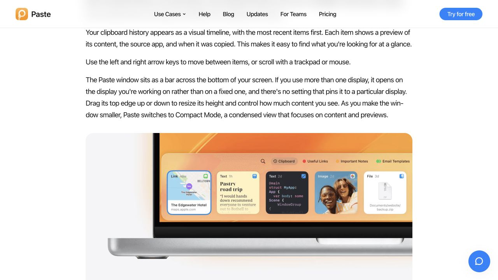

> **Historical record — archived 2026-10-21.** This document describes an earlier prototype or verification session, not the current implementation or current test results. Experiment commands, paths and generated evidence may no longer exist. See the [current documentation](../development.md) for supported behavior and development commands.

# Copiggy：Clipbara / Paste 设计参考

日期：2026-10-20。范围：官方产品截图、操作文档及 Clipbara 材质源码研究；未安装或实测竞品。

## 判断

建议恢复克制的玻璃外壳，保留本轮字号、对齐与留白。外层材质建立桌面悬浮关系，内容区域负责稳定可读。当前建议不是用户已确认的新实施指令；本轮未修改原型。

## Clipbara

- 官方流程为唤起历史 → 选择记录回填剪贴板并关闭 → 用户自己 ⌘V，符合 Copiggy 的控制边界。
- 官方历史截图中内容占卡片主体，来源应用为右上小图标，时间/字符数退居辅助层。
- 面板源码使用 VisualEffectBackground，浅色 popover、深色 hudWindow，底层 NSVisualEffectView behindWindow。这是系统模糊材质的证据，不能据此称为新版 Liquid Glass。
- 空格 Quick Look、文本编辑及右键管理体现按需显示。Copiggy 可保留已有右侧预览，不必照搬横向卡片。

来源：
- https://github.com/mobrava/Clipbara#usage
- https://raw.githubusercontent.com/mobrava/Clipbara/main/docs/assets/screenshot-history-panel.png
- https://github.com/mobrava/Clipbara/blob/main/Clipbara/Views/HistoryPanelView.swift
- https://github.com/mobrava/Clipbara/blob/main/Clipbara/Panel/VisualEffectBackground.swift

## Paste

- 官方 Mac 使用文档截图已在浏览器查看：半透明底部容器内排列可辨识的内容卡片，文字/代码/图片采用适合自身内容的预览。可借鉴内容表达，不必迁移横向布局。
- 预览内支持编辑、图片旋转和文字提取，增强动作跟随选中内容。
- 搜索支持内容、类型、来源应用和日期，筛选条件嵌入搜索框。可作为历史变多后的改进，暂不增加常驻筛选栏。
- Pinboards 与多设备能力不属于当前精简面板的优先范围。

来源：
- https://pasteapp.io/help/paste-on-mac
- https://pasteapp.io/help/edit-items-before-pasting
- https://pasteapp.io/help/search-and-filters

浏览器截图：

## 建议下一版

1. 一层连续玻璃底：浅色中性半透明，深色烟灰半透明，避免多层玻璃胶囊。
2. 只保留用于识别窗口边缘的细描边和轻阴影，不恢复装饰光斑、发光按钮。
3. 保留纵向历史与按需右侧预览，内容左置，来源及锁角标右置。
4. 图片和 JSON 共享主体区域与底部信息/操作布局；长文本背后的材质更稳定。
5. 保留现有字号与24px留白作为起点；在亮/暗和复杂背景上检查文字对比度。
6. 防误贴范围与增强结果继承继续成为核心流程；低频管理收入右键/更多菜单。

限制：这是一轮基于官方资料的设计研究，不是竞品可用性实测。尚未验证真实背景变化、键盘焦点、动态模糊性能或辅助功能完整性。没有改动 Copiggy 源码或原生应用。
